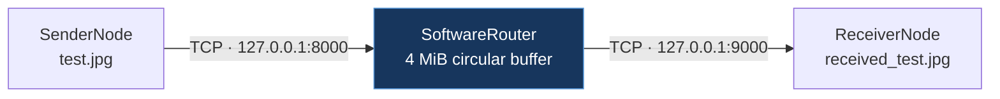
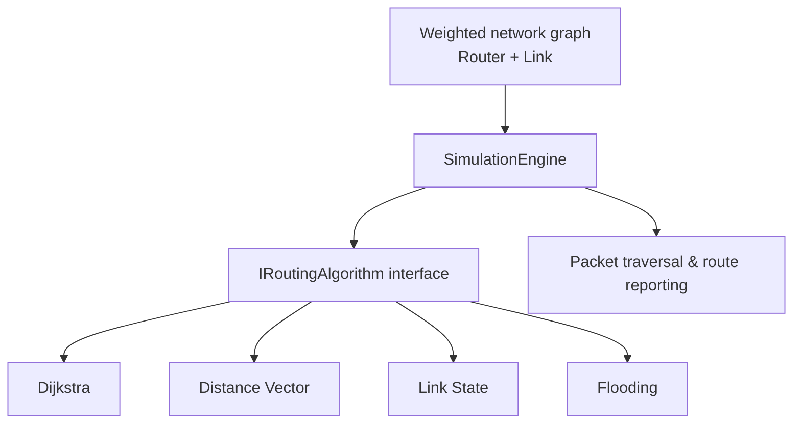
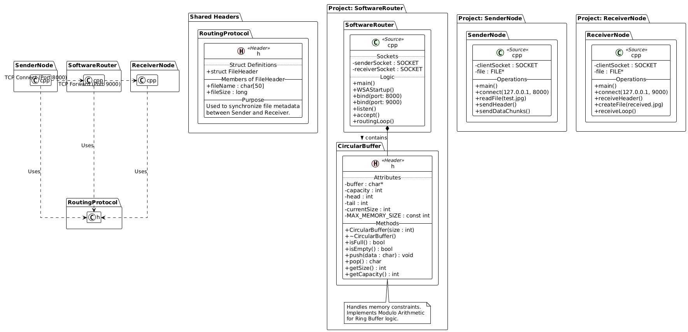
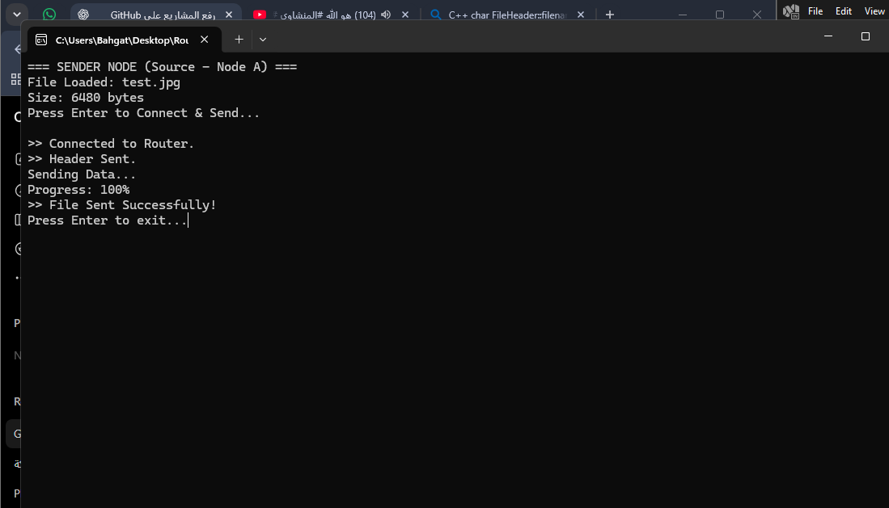
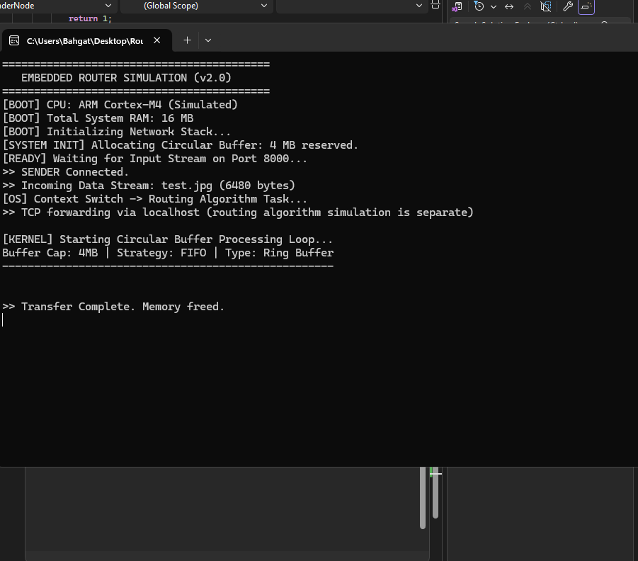
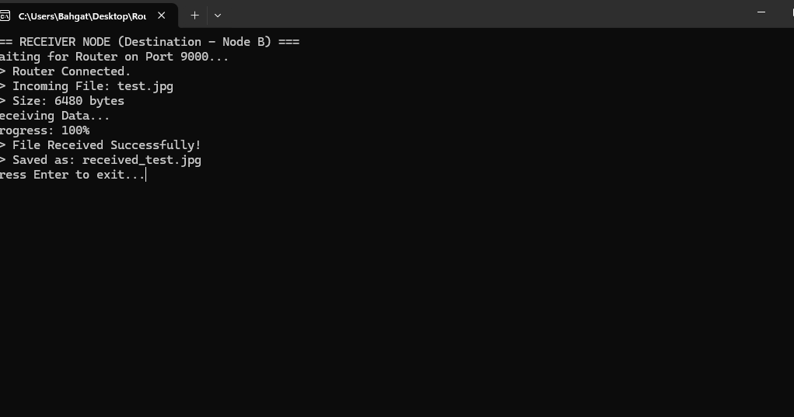

<div align="center">

# NETWORK ROUTING ALGORITHMS SIMULATOR

### Routing intelligence, packet-flow simulation, and reliable TCP file transfer — built with modern C++.

**An educational networking systems project exploring how routing decisions are modeled, evaluated, and observed.**

[](https://isocpp.org/)
[](https://www.microsoft.com/windows)
[](https://visualstudio.microsoft.com/)
[](#tcp-transfer-pipeline)

[**Overview**](#overview) · [**Architecture**](#architecture) · [**Algorithms**](#routing-algorithms) · [**Quick Start**](#quick-start) · [**Verification**](#verified-results) · [**Screenshots**](#live-demo--screenshots) · [**Documentation**](#documentation)

</div>

---

## Overview

**Network Routing Algorithms Simulator** is a C++ educational project with two complementary areas:

1. **Routing simulation** — graph-based routers, weighted links, routing tables, packet traversal, and implementations of four routing strategies.
2. **TCP transfer demonstration** — three Windows console applications that send an image through a software router to a receiver, with a bounded circular buffer and robust send/receive helpers.

The original [academic project proposal](Project_Proposal.pdf) defines a larger goal: compare routing methods on the same topology using path cost, hop count, control-message overhead, and convergence behavior.

> [!IMPORTANT]
> **Architectural distinction:** The TCP demo forwards data over a fixed `localhost` route. Its forwarding path **does not dynamically use the routing-algorithm results**. The algorithm components and the TCP transport demo are separate parts of the current project.

## At a glance

| Area | Implementation | Current evidence |
|:---|:---|:---|
| Core language | C++ with Visual Studio solution | Successfully rebuilt on Windows (Debug / x64) |
| Network modeling | Routers, links, packets and routing tables | Source implementation present |
| Routing strategies | Dijkstra, Distance Vector, Link State, Flooding | Implementations present; comprehensive comparative validation pending |
| Transport | TCP sockets through Winsock2 | End-to-end local transfer tested |
| Buffer management | FIFO circular/ring buffer in router demo | Exercised during transfer |
| Integrity check | SHA-256 comparison of input and received image | **Matching hashes confirmed** |

## Architecture

### 1. TCP transfer pipeline



The applications use a shared `TransferProtocol.h` for transfer metadata and helpers. The router reports an **ARM Cortex-M4 / 16 MB environment as a simulation**; it is **not running on physical Cortex-M4 hardware**.

### 2. Routing simulation design



The simulation engine builds routing tables and follows next-hop entries for a source/destination pair. **Do not interpret this diagram as dynamic routing of the TCP image transfer.**



*Class diagram supplied with the project; see the [proposal](Project_Proposal.pdf) for the original design and flowchart.*

## Routing algorithms

| Strategy | Concept | Current implementation notes |
|:---|:---|:---|
| **Shortest Path First (Dijkstra)** | Finds least-cost paths on nonnegative-weight graphs | Builds per-router forwarding entries and next hops |
| **Distance Vector (Bellman–Ford style)** | Exchanges neighbor distance information until updates stabilize | Tracks convergence rounds and an estimated control-message count |
| **Link State (OSPF-style educational model)** | Uses topology knowledge to calculate routes | Delegates shortest-path calculation to Dijkstra; **not a full OSPF implementation** |
| **Flooding** | Disseminates traffic over multiple outgoing links | Currently creates direct-neighbor forwarding entries; **full packet flooding is not implemented** |

**Measurement scope:** The project contains facilities for reporting hop count and cost, plus selected control-message and convergence counters. A **validated, apples-to-apples benchmark across all four strategies is not yet available**. See [Engineering Roadmap](#engineering-roadmap).

## TCP transfer pipeline

1. `SenderNode` reads `test.jpg` and establishes a TCP connection to the router on port `8000`.
2. It sends `FileHeader` metadata followed by the image bytes in chunks.
3. `SoftwareRouter` receives the stream, processes it through a FIFO circular buffer, and forwards the bytes to port `9000`.
4. `ReceiverNode` reconstructs the received file as `received_test.jpg`.
5. File hashes can be compared to verify byte-for-byte integrity.

The transfer helpers handle partial socket operations; the demo reports errors when data cannot be fully sent or received. The transfer is **local-machine networking**, not a deployed multi-router network.

## Quick start

### Requirements

- **Windows** (Winsock2-based implementation)
- **Visual Studio** with the **Desktop development with C++** workload
- MSVC toolchain and Windows SDK
- C++17-capable compiler

### Build

1. Clone the repository:

   ```powershell
   git clone https://github.com/AhmedBahgat-22/Network-Routing-Algorithms-Simulator.git
   cd Network-Routing-Algorithms-Simulator
   ```

2. Open **`RoutingSimulator/RoutingSimulator.slnx`** in Visual Studio.
3. Set the configuration to **Debug | x64** and select **Build → Rebuild Solution**.
4. Verify all three applications build: **SenderNode**, **ReceiverNode**, and **SoftwareRouter** (the `RoutingSimulator` source-project directory is named differently from the Visual Studio project).

### Run the transfer demo

Run the programs in this order, keeping the earlier console windows open:

| Order | Startup project | Expected behavior |
|:---:|:---|:---|
| 1 | **ReceiverNode** | Waits for router connection on port `9000` |
| 2 | **SoftwareRouter** | Waits for sender input on port `8000` |
| 3 | **SenderNode** | Reads `test.jpg`; press **Enter** to transmit |

In Visual Studio, right-click the project → **Set as Startup Project**, then press **Ctrl + F5**. Ensure `test.jpg` is in the **process working directory** (the path is relative, not necessarily the folder containing the `.cpp` file).

> [!TIP]
> The receiver writes `received_test.jpg` in its working directory. To find it, run `Get-ChildItem -Recurse -Filter received_test.jpg` from the repository root.

## Verified results

A local **Windows / Visual Studio / Debug x64** execution was completed on **29 October 2026**. The build succeeded for all three projects, and the image was sent through the router and received under its expected output name.

| Check | Observed result |
|:---|:---|
| Solution rebuild | **3 succeeded · 0 failed · 0 skipped** |
| Sender → router | Connected; header transmitted; data progress reached **100%** |
| Router → receiver | TCP forwarding completed |
| Receiver | `received_test.jpg` saved; **6,480 bytes** |
| File integrity | **SHA-256 matched across original, sender copy, and received file** |

**SHA-256 (all three files):**

```text
B136FD9635375A16AEC1BD8C8A112DDEE48A646B98C096AEAE872400773CCB45
```

Reproduce the integrity check in PowerShell:

```powershell
Get-ChildItem -Recurse -File |
  Where-Object { $_.Name -in @('test.jpg', 'received_test.jpg') } |
  ForEach-Object {
    [PSCustomObject]@{
      File   = $_.FullName
      Size   = $_.Length
      SHA256 = (Get-FileHash -LiteralPath $_.FullName -Algorithm SHA256).Hash
    }
  } | Format-List
```

> [!NOTE]
> This verifies **one end-to-end local file-transfer test**. It does not establish routing-algorithm correctness over arbitrary topologies, production reliability, high-load throughput, or performance superiority.

## Live demo & screenshots

Real console captures from the **29 October 2026** Windows Debug/x64 transfer test. The three applications run locally and demonstrate a successful 6,480-byte file transfer; **these screenshots do not represent a dynamic multi-router deployment**.

### 01 — SenderNode | Image transmission



*The sender opens `test.jpg`, connects to the software router on port `8000`, and reports successful transmission.*

### 02 — SoftwareRouter | Buffered TCP forwarding



*The router handles the incoming file stream and forwards it to the receiver; Cortex-M4 information displayed in the console is simulated.*

### 03 — ReceiverNode | Successful reception



*The receiver reports 100% completion and saves `received_test.jpg` (6,480 bytes). The SHA-256 values match those of the original test image, as documented above.*

## Repository structure

```text
Network-Routing-Algorithms-Simulator/
├── README.md
├── Project_Proposal.pdf
├── Project_Report.pdf
├── REVIEW_NOTES.md
├── UML_Diagram.png
├── .gitignore
├── docs/
│   └── screenshots/
│       ├── sender-node.png
│       ├── software-router.png
│       └── receiver-node.png
└── RoutingSimulator/
    ├── RoutingSimulator.slnx
    ├── TransferProtocol.h
    ├── test.jpg
    ├── SenderNode/
    │   ├── SenderNode.cpp
    │   └── SenderNode.vcxproj
    ├── ReceiverNode/
    │   ├── ReceiverNode.cpp
    │   └── ReceiverNode.vcxproj
    └── RoutingSimulator/
        ├── RoutingSimulator.cpp
        ├── RoutingSimulator.vcxproj
        ├── SimulationEngine.h
        ├── IRoutingAlgorithm.h
        ├── DijkstraAlgorithm.h
        ├── DistanceVectorAlgorithm.h
        ├── LinkStateAlgorithm.h
        ├── FloodingAlgorithm.h
        └── ... graph, packet, and metrics headers
```

*Generated Visual Studio artifacts are excluded by `.gitignore`; the received test image is also ignored.*

## Engineering roadmap

- [x] Implement a modular C++ network model and routing strategy classes.
- [x] Add Sender / Router / Receiver TCP demonstration.
- [x] Implement partial-send / partial-receive handling for transfer helpers.
- [x] Resolve compilation errors and rebuild all three projects on Windows.
- [x] Verify one transfer with matching SHA-256 hashes.
- [ ] Write automated routing tests for known topologies and unreachable destinations.
- [ ] Correct and validate path-cost accumulation in packet traversal.
- [ ] Implement true flooding behavior with duplicate / TTL control.
- [ ] Produce a reproducible cross-algorithm comparison of hops, cost, control overhead, and convergence.
- [ ] Serialize transfer metadata in a defined portable wire format.
- [ ] Add CI builds and repeatable test automation.
- [ ] Optionally connect route decisions to simulated packet forwarding without misrepresenting real TCP routing.

## Documentation

| Resource | Contents |
|:---|:---|
| [**Project Proposal**](Project_Proposal.pdf) | Original scope, goals, system design, UML, flowchart, and bibliography |
| [**Project Report**](Project_Report.pdf) | Supplied academic report |
| [**UML Diagram**](UML_Diagram.png) | High-level class design |
| [**Review Notes**](REVIEW_NOTES.md) | Known issues, prior changes, and implementation constraints |

## Design considerations

<details>
<summary><strong>Technical boundaries and known limitations</strong></summary>

- The TCP transfer uses a hard-coded loopback path, not topology-aware forwarding.
- The `FileHeader` representation is based on native C++ struct layout; a stable wire format would be preferable for cross-platform interoperability.
- Socket/resource cleanup and negative-path tests can be strengthened further.
- Dijkstra assumes nonnegative link weights; invalid graph data should be rejected during topology construction.
- Routing metric definitions and per-hop cost accounting need rigorous verification before publishing comparisons.

</details>

## Author

**Ahmed Bahgat (Ahmed Abdelmoula)**  
Computer Engineering · Istanbul Arel University  
Student ID: **220303923**

[GitHub Profile](https://github.com/AhmedBahgat-22) · [Project Repository](https://github.com/AhmedBahgat-22/Network-Routing-Algorithms-Simulator)

---

<div align="center">

**Built to make routing algorithms observable, testable, and easier to understand.**

*Educational / academic project — not affiliated with Microsoft or any networking vendor.*

</div>
